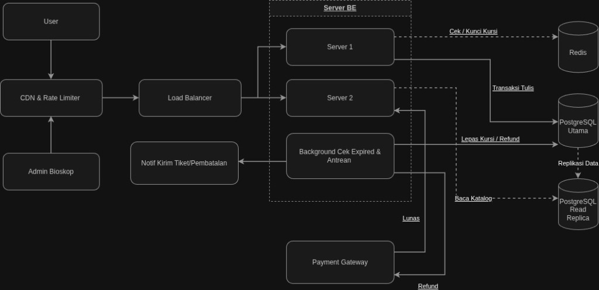
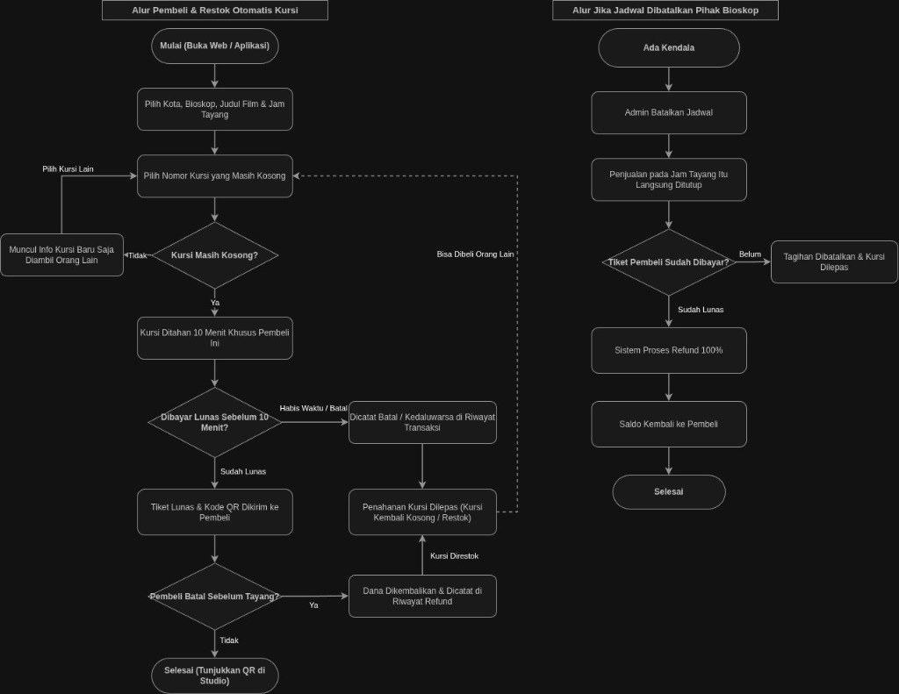
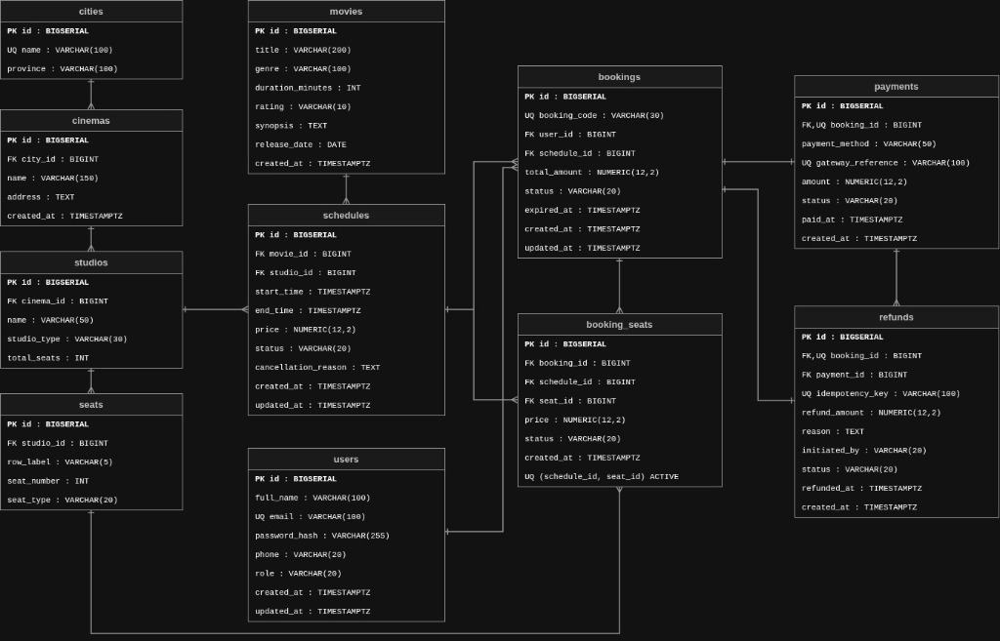

# Backend Development Test – PT Mitra Kasih Perkasa (MKP)

| Keterangan | Detail |
| :--- | :--- |
| **Nama Lengkap** | **Arfa Zaim Al Murtadlo** |
| **Posisi** | Backend Engineer (Golang) |
| **Studi Kasus** | Platform Pembelian Tiket Bioskop Online |

---

## A. System Design Test

### Topologi Sistem (Skala Nasional & Banyak Cabang Kota)



Pada jaringan bioskop berskala nasional, jumlah pengunjung yang **melihat jadwal dan denah kursi** jauh lebih besar dibanding yang **sedang menekan bayar**. Agar sistem tetap cepat diakses banyak orang kapan saja, beban baca dan beban transaksi dipisahkan:

- **User & Admin Bioskop → CDN & Rate Limiter:** Menyimpan gambar poster agar cepat dimuat dari berbagai kota tanpa membebani server utama, sekaligus membatasi klik berlebih atau bot pemborong tiket.
- **Load Balancer → Server BE (Server 1, Server 2, dst.):** Membagi antrean pengunjung secara merata ke beberapa server Golang. Karena login memakai token JWT (tanpa menyimpan sesi di satu server), jumlah server mudah ditambah saat penonton membludak.
- **Redis (Cek / Kunci Kursi):** Menyimpan status kursi di memori super cepat dan menahan kursi selama 10 menit saat dipilih, sehingga ribuan orang bisa membuka studio yang sama tanpa membuat database melambat.
- **PostgreSQL Utama & PostgreSQL Read Replica:**
  - **Read Replica** khusus melayani pembacaan daftar kota, cabang bioskop, film, dan jadwal tayang.
  - **PostgreSQL Utama** khusus memproses transaksi tulis (mengunci kursi, pembayaran lunas, pelepasan kursi, dan pencatatan refund), lalu menyalin pembaruannya ke Read Replica.
- **Background Cek Expired & Antrean:** Berjalan otomatis di belakang layar untuk melepas kursi yang lewat batas bayar 10 menit, memproses antrean pengembalian dana ke **Payment Gateway**, dan meneruskan pemberitahuan ke **Notif Kirim Tiket/Pembatalan**.

---

### Tugas 
### 1: Flowchart Sistem



Cara kerja sistem jika dijelaskan dalam bahasa sehari-hari terbagi menjadi dua alur sederhana:

1. **Alur Pembeli & Restok Otomatis Kursi**
   - Pembeli membuka aplikasi web, memilih kota, cabang bioskop, film, jam tayang, lalu memilih nomor kursi yang masih kosong.
   - Jika pada detik yang sama kursi itu baru saja diambil orang lain, layar langsung memberi tahu agar pembeli memilih kursi lain.
   - Jika kosong, **kursi ditahan 10 menit khusus untuk pembeli tersebut** supaya tidak diserobot orang lain selagi membayar.
   - **Bila lunas sebelum 10 menit:** E-Tiket beserta kode QR langsung terbit untuk ditunjukkan di pintu studio.
   - **Bila lewat 10 menit belum dibayar atau dibatalkan:** Transaksi tetap tercatat sebagai batal/kedaluwarsa di riwayat, lalu penahanan kursi dilepas otomatis sehingga kursi kembali kosong (**restok**) dan bisa dibeli orang lain.
   - **Bila pembeli membatalkan tiket lunas sebelum jam tayang:** Dana dikembalikan, tercatat di riwayat refund, dan kursinya otomatis kembali kosong (**restok tiket terjual**) untuk penonton lain.

2. **Alur Jika Jadwal Dibatalkan Pihak Bioskop**
   - Jika ada kendala di bioskop (misalnya proyektor rusak atau listrik padam), Admin membatalkan jadwal tayang tersebut beserta alasannya.
   - Penjualan pada jam tayang itu langsung ditutup agar tidak ada pembeli baru.
   - Untuk pesanan yang **belum dibayar**, tagihan otomatis dibatalkan dan kursi dilepas.
   - Untuk pesanan yang **sudah lunas**, sistem otomatis memproses **pengembalian dana (refund) 100%** ke saldo/metode bayar pembeli dan mengirimkan pemberitahuan.

---

### 2: Solusi Pemilihan Kursi, Restok Tiket Terjual, dan Refund Bioskop

#### 1. Pemilihan Tempat Duduk 
- **Menjaga performa saat diakses banyak orang:** Pencarian jadwal cabang kota diarahkan ke **PostgreSQL Read Replica**, sedangkan peta ketersediaan kursi dibaca dari **Redis**. Beban pembacaan massal tidak menumpuk di database transaksi utama.
- **Mencegah satu kursi dipakai dua orang (penguncian 2 lapis):**
  1. **Lapis pertama di Redis:** Begitu tombol pesan ditekan, kursi langsung dikunci sementara selama 10 menit di Redis. Klik dari orang kedua yang masuk sepersekian detik kemudian langsung tertolak di depan tanpa membebani database.
  2. **Lapis kedua di PostgreSQL:** Transaksi disimpan secara atomik. Jika memesan beberapa kursi sekaligus (misalnya `A1` dan `A2`), penguncian diurutkan dari ID kursi terkecil agar bebas *deadlock*. Di tabel `booking_seats` dipasang *partial unique index* khusus kursi aktif:
     ```sql
     CREATE UNIQUE INDEX uq_active_schedule_seat
         ON booking_seats (schedule_id, seat_id)
         WHERE status IN ('LOCKED', 'BOOKED');
     ```
     Dengan aturan ini di level database, satu nomor kursi pada jadwal yang sama dijamin tidak mungkin tercatat ganda meskipun terjadi klik bersamaan.

#### 2. Sistem Pencatatan & Restok Tiket yang Telah Terjual
- **Semua histori tetap tercatat:** Data pesanan yang gagal bayar, dibatalkan, maupun di-refund **tidak pernah dihapus (`DELETE`)** agar pembukuan dan audit transaksi tetap utuh.
- **Mekanisme status & restok otomatis:**
  - Baru pilih kursi (tahan 10 menit): booking `PENDING`, kursi `LOCKED`.
  - Pembayaran berhasil: booking `PAID`, kursi `BOOKED`.
  - Lewat 10 menit belum bayar: *background worker* rutin memeriksa pesanan lewat batas waktu (`FOR UPDATE SKIP LOCKED`), mengubah booking menjadi `EXPIRED`, dan mengubah status kursi menjadi `RELEASED`.
  - Tiket terjual (`PAID`) yang dibatalkan sebelum tayang: booking berubah menjadi `REFUNDED`, tercatat di tabel `refunds`, dan status kursi diubah menjadi `RELEASED`.
- Karena aturan unik `uq_active_schedule_seat` hanya mengunci status `LOCKED` dan `BOOKED`, begitu kursi berubah menjadi `RELEASED`, **nomor kursi tersebut otomatis tersedia kembali pada detik itu juga** untuk dipesan penonton berikutnya sebagai transaksi baru.

#### 3. Alur Refund / Pembatalan dari Pihak Bioskop
1. Admin membatalkan jadwal melalui endpoint khusus Admin disertai alasan pembatalan; status jadwal berubah menjadi `CANCELLED` sehingga tertutup bagi pemesanan baru.
2. Seluruh pesanan `PENDING` pada jadwal tersebut langsung diubah menjadi `CANCELLED` dan kursinya `RELEASED` agar penonton tidak telanjur membayar.
3. Seluruh pesanan yang sudah `PAID` otomatis dibuatkan data pengembalian dana 100% di tabel `refunds` (`initiated_by = 'CINEMA'`).
4. Permintaan pencairan dana ke Payment Gateway menyertakan kunci unik per pesanan (`idempotency_key`). Jika jaringan sempat terputus dan worker mengulang pengiriman (*retry*), Payment Gateway mengenali kunci yang sama sehingga dana tidak pernah cair dua kali.
5. Setelah berhasil, status pesanan tercatat `REFUNDED` dan penonton menerima notifikasi pembatalan beserta bukti pengembalian dana.

---

## B. Database Design Test

- **Gambar ERD (JPG):** [`docs/database-erd.jpg`](docs/database-erd.jpg)
- **Script PostgreSQL Siap Impor:** [`database/schema.sql`](database/schema.sql)



Rancangan database `db_bioskop` terdiri dari **11 tabel** yang saling berelasi:

| No | Nama Tabel | Fungsi & Detail Kolom Utama |
| :-: | :--- | :--- |
| 1 | `cities` | Daftar kota jaringan bioskop nasional (`id`, `name` unik, `province`). |
| 2 | `cinemas` | Cabang bioskop per kota (`id`, `city_id`, `name`, `address`). |
| 3 | `studios` | Ruang studio tiap cabang (`id`, `cinema_id`, `name`, `studio_type` Regular/IMAX, `total_seats`). |
| 4 | `seats` | Daftar nomor kursi fisik per studio (`id`, `studio_id`, `row_label`, `seat_number`, unik per studio). |
| 5 | `movies` | Data film (`id`, `title`, `genre`, `duration_minutes`, `rating`, `synopsis`, `release_date`). |
| 6 | `schedules` | Jadwal tayang (`id`, `movie_id`, `studio_id`, `start_time`, `end_time`, `price`, `status`, `cancellation_reason`). |
| 7 | `users` | Akun pengguna (`id`, `full_name`, `email` unik, `password_hash` bcrypt, `phone`, `role` `ADMIN`/`CUSTOMER`). |
| 8 | `bookings` | Transaksi pemesanan (`id`, `booking_code` unik, `user_id`, `schedule_id`, `total_amount`, `status`, `expired_at`). |
| 9 | `booking_seats` | Detail kursi per pesanan (`booking_id`, `schedule_id`, `seat_id`, `price`, `status` `LOCKED`/`BOOKED`/`RELEASED` + indeks unik kursi aktif). |
| 10 | `payments` | Catatan pembayaran lunas (`id`, `booking_id` unik, `payment_method`, `gateway_reference` unik, `amount`, `paid_at`). |
| 11 | `refunds` | Catatan pengembalian dana (`id`, `booking_id` unik, `payment_id`, `idempotency_key` unik, `refund_amount`, `reason`, `initiated_by`, `status`). |

---

## C. Skill Test

Dibangun menggunakan **Golang**, **Gin**, **GORM**, **PostgreSQL**, **JWT (HS256)**, dan **bcrypt**, serta dilengkapi tampilan Webapp interaktif **Zanema** untuk mencoba alur pemesanan secara langsung.

```text
bioskop-mkp/
├── cmd/main.go                             # Entrypoint server, router & worker auto-expire kursi
├── database/schema.sql                     # DDL PostgreSQL (11 tabel, indeks) & data awal (seed)
├── docs/                                   # Export JPG: system-topology, system-flowchart, database-erd
├── internal/
│   ├── config/database.go                  # Koneksi GORM PostgreSQL
│   ├── middleware/auth_middleware.go       # Middleware Authorization Bearer JWT & Role (ADMIN/CUSTOMER)
│   ├── model/models.go                     # Entitas tabel & DTO request/response
│   ├── repository/                         # Query user, jadwal anti-bentrok, kunci kursi & auto-refund
│   ├── service/                            # Logika bisnis & unit test
│   └── handler/                            # HTTP Handler Gin
├── postman/
│   └── bioskop_mkp.postman_collection.json # Export Postman Collection siap impor
└── web/                                    # Webapp interaktif Zanema (Katalog, Kursi, Bayar, E-Tiket, Admin)
```

### Daftar Endpoint API

#### 1. API Login User 
| Method | Endpoint | Authorization | Keterangan |
| :--- | :--- | :--- | :--- |
| `POST` | `/api/v1/auth/login` | Publik | Login user & menghasilkan Bearer Token JWT |
| `POST` | `/api/v1/auth/register` | Publik | Registrasi akun pelanggan baru (`CUSTOMER`) |
| `GET` | `/api/v1/auth/me` | Bearer JWT (`ADMIN` / `CUSTOMER`) | Mengambil profil user yang sedang login |

#### 2. API CRUD Data Jadwal Tayang 
| Method | Endpoint | Authorization | Keterangan |
| :--- | :--- | :--- | :--- |
| `GET` | `/api/v1/schedules` | Bearer JWT (`ADMIN` / `CUSTOMER`) | Melihat daftar jadwal tayang (filter: `movie_id`, `studio_id`, `cinema_id`, `status`, `date`) |
| `GET` | `/api/v1/schedules/:id` | Bearer JWT (`ADMIN` / `CUSTOMER`) | Melihat detail satu jadwal tayang |
| `POST` | `/api/v1/schedules` | Bearer JWT (Khusus `ADMIN`) | Menambah jadwal tayang baru (menolak otomatis jika jam di studio bentrok) |
| `PUT` | `/api/v1/schedules/:id` | Bearer JWT (Khusus `ADMIN`) | Mengubah data jadwal tayang |
| `PATCH` | `/api/v1/schedules/:id/cancel` | Bearer JWT (Khusus `ADMIN`) | Membatalkan jadwal dari pihak bioskop + otomatis refund 100% pesanan `PAID` |
| `DELETE` | `/api/v1/schedules/:id` | Bearer JWT (Khusus `ADMIN`) | Menghapus jadwal tayang yang belum memiliki transaksi terbayar |

#### Endpoint Pendukung Pemesanan Kursi 
| Method | Endpoint | Authorization | Keterangan |
| :--- | :--- | :--- | :--- |
| `GET` | `/` | Publik | Halaman Webapp pemesanan tiket **Zanema** |
| `GET` | `/health` | Publik | Cek status server & koneksi PostgreSQL |
| `GET` | `/api/v1/catalog/metadata` | Publik | Data kota, cabang bioskop, studio, dan katalog film |
| `GET` | `/api/v1/catalog/schedules` | Publik | Daftar jadwal tayang publik untuk halaman Webapp |
| `GET` | `/api/v1/catalog/schedules/:id/seats` | Publik | Status kursi studio secara *real-time* (`AVAILABLE`, `LOCKED`, `BOOKED`) |
| `POST` | `/api/v1/bookings` | Bearer JWT | Mengunci kursi pilihan selama 10 menit |
| `GET` | `/api/v1/bookings` | Bearer JWT | Riwayat pesanan & E-Tiket milik user |
| `POST` | `/api/v1/bookings/:id/pay` | Bearer JWT | Pembayaran pesanan & penerbitan E-Tiket |
| `POST` | `/api/v1/bookings/:id/cancel` | Bearer JWT | Pembatalan pesanan oleh pelanggan & restok kursi otomatis |

---

## Cara Menjalankan & Menguji

### 1. Impor Script PostgreSQL
Buat database `db_bioskop` lalu jalankan [`database/schema.sql`](database/schema.sql):
```bash
createdb -U postgres db_bioskop
psql -U postgres -d db_bioskop -f database/schema.sql
```

### 2. Konfigurasi `.env` & Jalankan Server Golang
```bash
cp .env.example .env
# Sesuaikan DB_USER / DB_PASSWORD di .env dengan PostgreSQL lokal Anda

go test -v ./...
go run ./cmd
```
- Server berjalan di **`http://localhost:8080`** (buka di browser untuk mencoba langsung).

### 3. Uji API Menggunakan Export Postman
1. Impor file [`postman/bioskop_mkp.postman_collection.json`](postman/bioskop_mkp.postman_collection.json) ke Postman.
2. seeder dari `schema.sql`:
   - **Admin Bioskop (`ADMIN`):** `admin@cinema.com` / `admin123`
   - **Pelanggan (`CUSTOMER`):** `arfa@cinema.com` , `zaim@cinema.com` & `al@cinema.com` / `password`
3. Jalankan **1. Akun & Login → Login Admin** dan **Login Pelanggan** (token JWT otomatis tersimpan ke `{{token}}` dan `{{customer_token}}`), lalu jalankan seluruh request di folder **2. Jadwal Tayang** serta **3. Pemesanan Kursi & Restok Tiket** (atau jalankan sekaligus lewat **Run Collection** di Postman).
